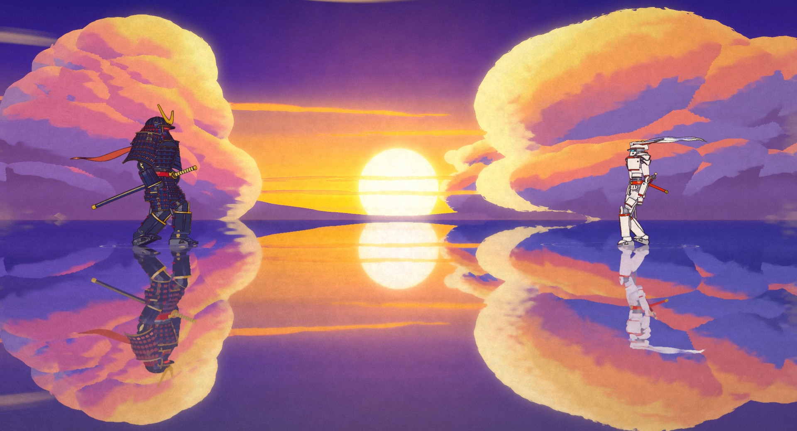
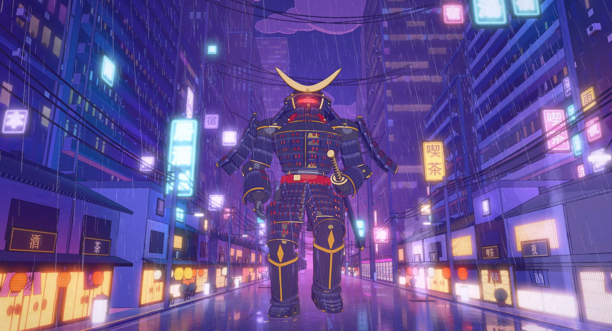
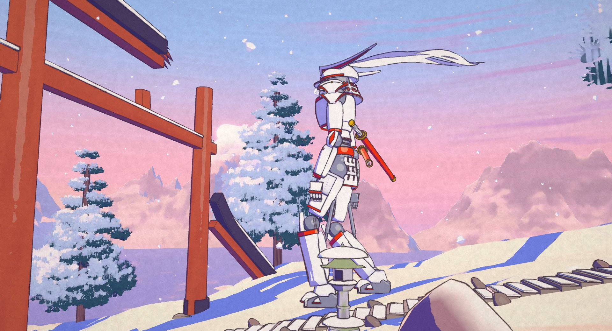
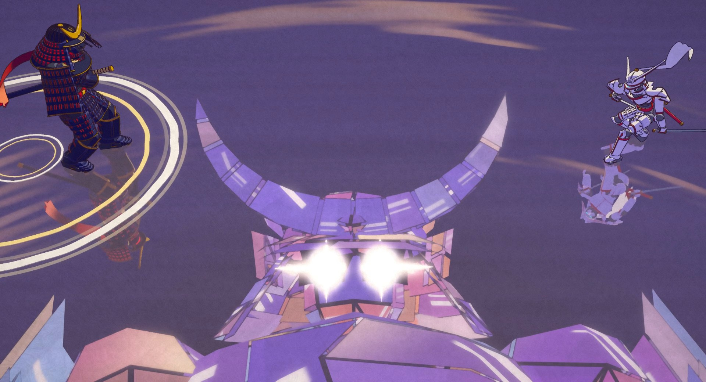
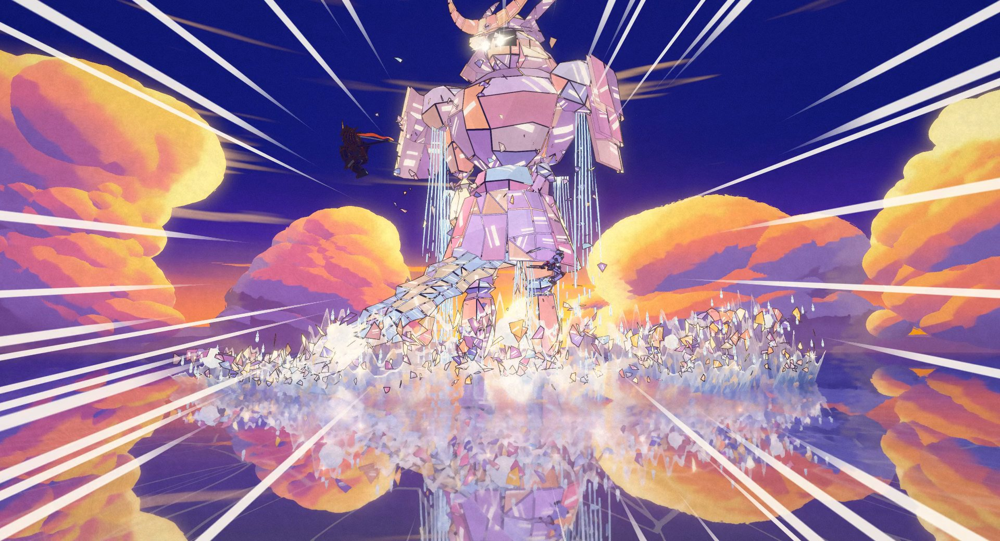
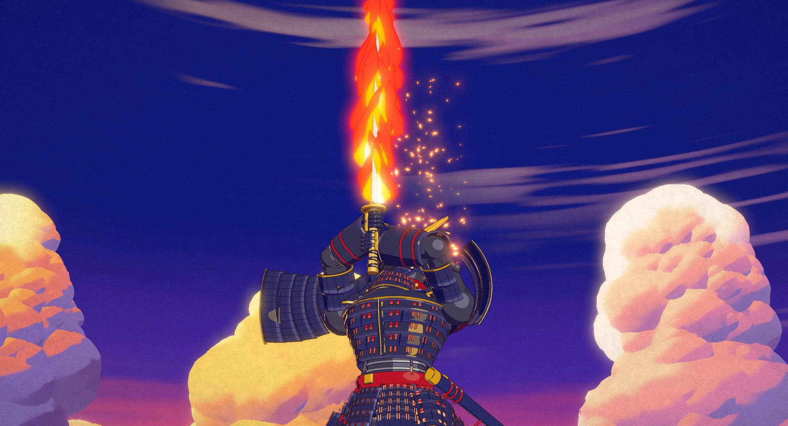
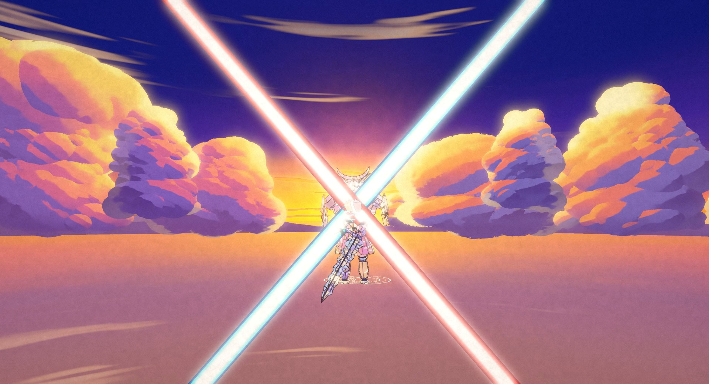
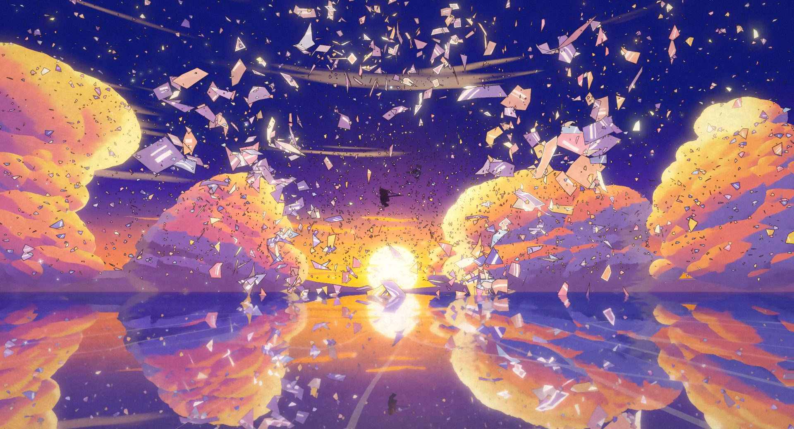

# KAGAMI · 鏡

An 84-second anime short where every frame is rendered by code: no video model, no image model, no hand-drawn frames,
no external assets. Two rival mecha ronin cross their own worlds, a neon city in the rain and a snowy mountain pass at
dawn, to duel on an endless mirror lake at sunset. At the moment of the draw the reflection shows a third: a colossal
giant of mirror shards living under their feet, and the rivals have to cut it down together before they can bow and
walk away.



| | |
|---|---|
|  |  |
|  |  |
|  |  |

**Watch:** download `dist/kagami.html` and open it in any browser. It is one self-contained file (28 MB, a lighter
encode of the film with its soundtrack) and works offline. The full-quality MP4 is attached to the release (see
Releases).

---

## How it looks like anime

The film is a three.js (r160, WebGL2) scene drawn through a custom multi-pass pipeline (`src/anime/post.js`) that
imitates a cel + painted-background production:

| Pass | What it does |
|---|---|
| mirror | a camera mirrored about the water plane renders the reflection at half resolution; the lake, the wet street, the puddles and the ice sample it in screen space with ripple rings, rain wobble and smear. Objects on layer 2 exist only in the reflection (the giant before it breaks the surface, the omen twin in the puddle) |
| main (MRT) | colour + emissive, and a data buffer (view normal, depth, material id) |
| Kuwahara paint | depth-aware 8-sector anisotropic Kuwahara "brush" on painted pixels only (sky, clouds, sets) → gouache look; a gentler radius on mirrors so reflections keep their shapes |
| ink | hand-inked lines on cel pixels only: id / depth / normal edges, pressure noise, line boil on twos |
| atmosphere | depth haze, painted glows (sun, neon), light shafts |
| FX overlay | impact frames (inverted ink frame, white flash), drawn speed lines, lightning-style flash; the drawn FX geometry (rain, snow, water sheets, glass, sparks, slashes) are unlit cel FX ids that skip the ink |
| bloom | glow from emissive pixels only (eyes, neon, sun, the X-cut) |
| grade + grain | exposure, saturation, contrast, lift/gain, vignette, paper texture and film grain, fades |

* **Everything is 3D under the drawing.** The ronin are procedural hard-surface kits (superellipse shells, keeled and
  flared plates with bevelled edges, lacing, pistons) on a pivot rig, the scarf and plume are ribbons on bone chains.
  The giant UTSUSHI is hundreds of flat mirror shards that colour themselves from a designed sunset sky.
* **Characters are on twos, FX on threes**, like film anime: poses change 12 times a second, rain, glass and water
  8 times a second, cameras move on ones.
* **Every frame is a pure function of time.** Frames render in any order, so the render is chunked and resumable;
  chunks re-rendered from a fresh page are bit-identical.
* **The sound is fully synthesized** in Python with numpy: shakuhachi-like flute, koto plucks, taiko, choir, brass,
  temple bell, rain, wind, steps, glass and steel, no samples. 64 named hits are placed from the picture's event list so
  each one peaks one frame after its event; two true silences sit at the pass and at the X.
* **No image or video models, no downloaded art, no external assets.** Every texture (the neon kanji signs, lettered
  with the system's own fonts, snow, salt crust, cloud brushwork) is painted by code into canvases at load time.



## How it was made

One director session and parallel department agents, all working from a shared production bible
([CONTRACT.md](CONTRACT.md)): story, designs, sets, the 40-shot table, story cues, the department API and file
ownership. The director built the scaffold (engine, boot, shot table, colour script, render tools) and then the
departments ran at the same time, each owning its own files and checking its own work with rendered stills:

* **City**: the neon canyon street in the rain, towers, signs, wet street mirror and the causeway at dusk.
* **Lands**: the snowy pass at dawn (ridge, steps, broken gate, lanterns, pines, sea of clouds, frozen pond), the
  sunset mirror lake with its painted sky and clouds, and the sky set for the X.
* **Ronin**: SUMI and YUKI, their rigs, blades, scarf and plume, and the named poses.
* **FX**: the mirror giant UTSUSHI, rain, snow, water sheets, glass, sparks, slashes, the kaleidoscope shot, impact
  frames and the mirror pass in the engine.
* **Direction** (two departments, act one and act two): cameras, colour script per shot and choreography.
* **Sound**: the score and effects, built from the same shot table and event list as the picture.

Departments talked through requests in a shared status log, never by editing each other's files. After one round of
review stills and one round of fixes, the film was rendered once, start to finish.

**Numbers**

| | |
|---|---|
| length | 84 s, 2016 frames at 24 fps, 40 shots, 4 sets (city, pass, lake, sky), 3 characters |
| frame | 1920×1040, rendered at scale 2 (3840×2080 internally, downsampled in the page), one sample per frame |
| speed | about 460 ms per final frame including GPU readback, on one mid-range desktop GPU |
| render | 17 chunks of 120 frames, about 15.5 minutes for the whole film, plus 2.5 minutes of encoding |
| sound | 48 kHz 24-bit stereo, -14 LUFS, true peak under -2 dBTP, about 95 s to synthesize |
| code | about 9,500 lines of JavaScript for the film, 1,400 lines of Python for the tools and the score |

## Run it

Requirements: Python 3.11+, `pip install -r requirements.txt`, `playwright install chromium`, and `ffmpeg` on `PATH`
(or set `FFMPEG=/path/to/ffmpeg`). The shell scripts need bash (on Windows, Git Bash works).

Scrub the film live (any static server works; this one sends the right MIME types and no caching):

```bash
python tools/serve.py 8750
# open http://127.0.0.1:8750/index.html        (?s=2 for the final render scale, ?f=708 to start on a frame)
```

Free camera test view: `index.html?test=1&set=LAKE&cam=0,2,40&at=0,8,0&fov=35&t=29`.

Render stills for review (server running; `s:` shot, `t:` seconds, `f:` frame, `q:` a test view):

```bash
python tools/snap.py --port 8750 --scale 2 --out out/snap s:s14 t:61 f:1650 "q:test=1&set=LAKE&cam=0,2,40&at=0,8,0&fov=35&t=29=name:mytest"
```

Full build: picture (resumable lossless chunks), soundtrack, final MP4, single-file player:

```bash
bash tools/chunks.sh 2 8750          # -> out/chunks/c_NNNN.mkv (starts the server if needed)
python tools/sound/build.py          # -> out/audio/mix.wav, checks loudness, silences and hit sync
bash tools/finalize.sh               # -> out/kagami.mp4 (H.264 CRF 16 + AAC 192k)
python tools/player.py               # -> dist/kagami.html (2-pass H.264 lite encode, embedded, < 30 MB)
```

## Layout

```
index.html              workbench: scrub, play, shot timeline; ?headless=1 capture mode, ?s=2 render scale
CONTRACT.md             the production bible every department worked from
src/main.js             boot: renderer, AnimePost, scene, camera, sets, departments, window.FILM
src/shots.js            the 40 shots, story CUES, evalFrame(frame) -> state
src/look.js             colour script presets per set
src/anime/post.js       the anime pipeline: materials (cel, painted, mirror, cards, sky) and the post passes
src/city*.js            the neon city and the causeway
src/lands*.js           the pass, the lake, the sky
src/ronin.js, ronin/    SUMI and YUKI: kit, parts, rig, poses
src/giant.js            UTSUSHI, the mirror giant
src/fx*.js              rain, snow, water, glass, sparks, slashes, kaleidoscope (API in src/fx/README.md)
src/direction/          act1.js (s01-s20) and act2.js (s21-s40): cameras, looks, choreography
tools/                  serve, snap (stills), render + chunks + finalize (film), player (dist), sheet
tools/sound/            the synthesized soundtrack: dsp, instruments, score, master, check, events.json
vendor/                 three.module.js (r160)
dist/kagami.html        the offline player
docs/                   stills from the film
```

Code is MIT licensed (see [LICENSE](LICENSE)). The pass chain, the Kuwahara paint and the ink ideas were adapted from
"sunshower" (MIT); its licence line is kept in `src/anime/post.js`.

Made with Fable 5.5.
